# Portal APBDes Desa Sungai Pinang Nibung

Website untuk menampilkan Anggaran Pendapatan dan Belanja Desa (APBDes) Desa
Sungai Pinang Nibung, Kecamatan Sungai Pinang, Kabupaten Ogan Ilir. Warga bisa
melihat ringkasan pendapatan dan belanja, mencari rincian kegiatan, dan
mengecek dokumen sumber tiap angka tanpa perlu login. Perangkat desa yang
ditugaskan bisa masuk untuk menambah, mengubah, dan mengimpor data.

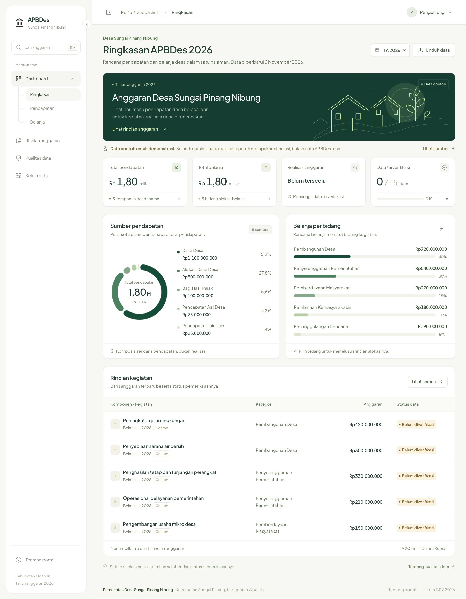

## Fitur

- Ringkasan per tahun: perbandingan pendapatan dan belanja (surplus/defisit),
  sumber pendapatan dalam diagram, dan belanja per bidang yang bisa diklik.
- Rincian anggaran dengan tab Pendapatan/Belanja, filter bidang dan status,
  serta unduh CSV sesuai filter yang dipakai.
- Pencarian dari menu samping (`Ctrl K` / `⌘ K` atau `/`). Semua kata harus
  ditemukan di uraian, bidang, atau sumber; hasil diurutkan dari yang paling
  cocok dan kata kuncinya ditandai.
- Halaman sumber data: daftar dataset dan status pemeriksaan tiap baris
  (terverifikasi, belum diverifikasi, belum tersedia).
- Realisasi, penyerapan, dan sisa anggaran hanya muncul kalau semua belanja
  tahun itu sudah terverifikasi dan bukan data contoh. Data yang belum ada
  ditulis "Belum tersedia", tidak dianggap nol.
- Halaman pengelola: tambah/ubah/hapus baris, impor CSV atau Excel dari
  template, riwayat aktivitas, dan riwayat dataset. Impor dibatalkan seluruhnya
  kalau ada satu baris yang salah.
- Data contoh selalu diberi label supaya tidak tertukar dengan data resmi.
- Menu samping bisa diringkas menjadi ikon saja. Di ponsel menu jadi laci
  samping dan tabel jadi kartu.

| Peran | Bisa apa |
| --- | --- |
| Pengunjung | Melihat ringkasan, rincian, sumber data, dan mengunduh CSV. |
| Pengelola | Semua di atas, ditambah mengelola dan mengimpor data anggaran. |

## Teknologi

- Laravel 13 (PHP 8.4+) dengan Blade
- MySQL untuk database aplikasi, SQLite in-memory untuk tes
- Vite, CSS biasa, Chart.js untuk diagram, ikon Lucide
- PhpSpreadsheet untuk membaca berkas .xlsx
- Huruf Plus Jakarta Sans (dibundel lewat Fontsource, jadi tidak butuh
  internet)

Struktur singkat: `app/Services` berisi perhitungan ringkasan dan impor,
`app/Support/BudgetSearch.php` logika pencarian, `resources/views` tampilan
Blade, `resources/css/app.css` gaya dasar, `resources/css/secondary.css`
penyesuaian, animasi, dan halaman login, `resources/js/app.js` interaksi,
`tests/` pengujian.

## Menjalankan di komputer sendiri

Perlu PHP 8.4 atau lebih baru (extension pdo_mysql, mbstring, fileinfo,
openssl, gd, zip, xml), MySQL, Composer, dan Node.js 20.19+.

```sh
composer install
npm install
npm run build
cp .env.example .env
php artisan key:generate
```

Buat database kosong `apbdes_nibung` di MySQL, sesuaikan `DB_*` di `.env`,
lalu:

```sh
php artisan migrate --seed
php artisan serve
```

Buka http://127.0.0.1:8000. Seeder membuat 15 baris data contoh dan satu akun
pengelola dari `APBDES_ADMIN_EMAIL` dan `APBDES_ADMIN_PASSWORD` di `.env`.
Ganti kata sandinya sebelum seeding kalau aplikasi dipakai sungguhan.

Saat mengubah tampilan, jalankan `npm run dev` bersamaan dengan
`php artisan serve` supaya halaman ter-refresh otomatis.

Tes otomatis (butuh extension pdo_sqlite):

```sh
php artisan test
```

## Impor data

Unduh template dari halaman Kelola data. Kolomnya: `year`, `type`
(`income`/`expense`), `category`, `description`, `amount`, `source`,
`verification_status`, `source_date`, `realization`. Nominal ditulis tanpa Rp
dan tanpa titik ribuan, misalnya `25000000`. Panduan lengkap ada di
`Panduan Website APBDes Nibung.pdf` yang dikirim bersama paket aplikasi.

## Catatan

Angka bawaan adalah data contoh, bukan APBDes resmi desa. Portal ini tidak
terhubung ke Siskeudes dan bukan pengganti Peraturan Desa tentang APBDes.

<details>
<summary>Tangkapan layar lain</summary>

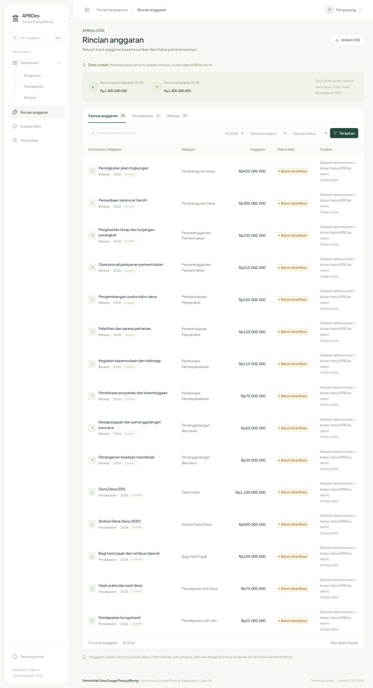
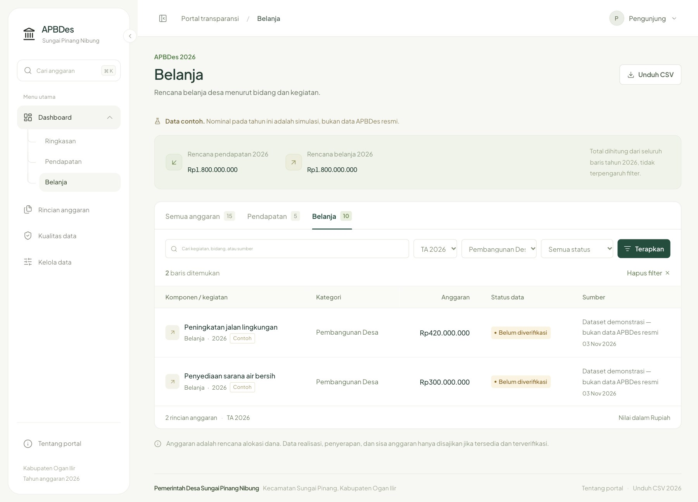
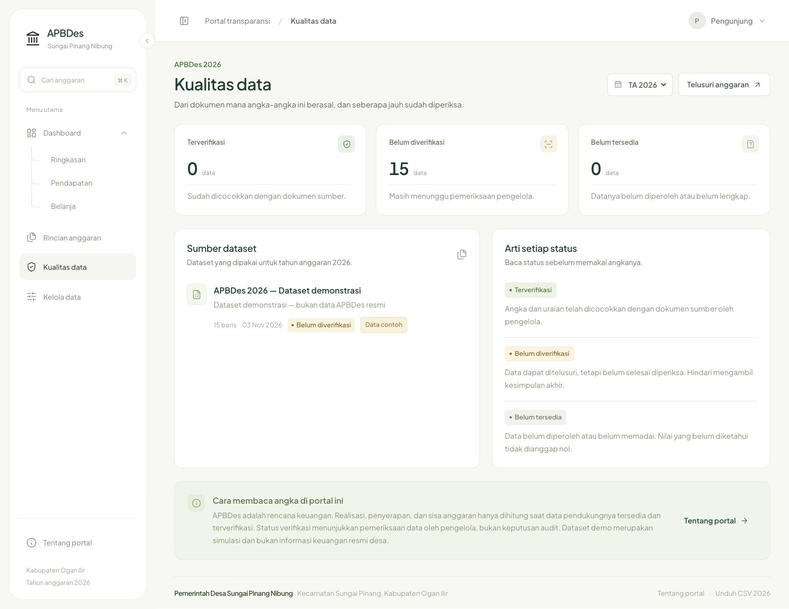
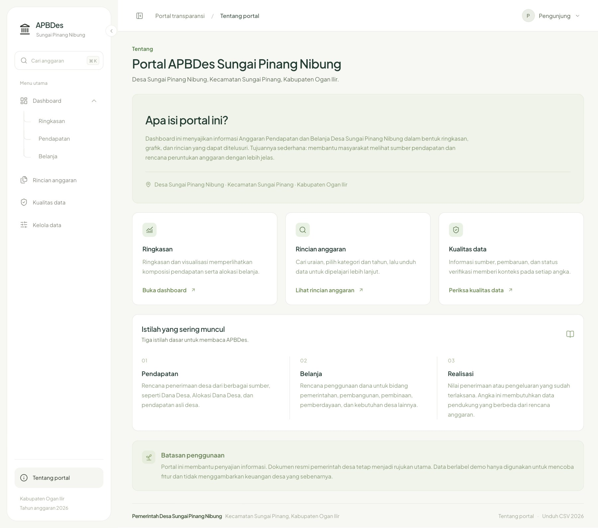
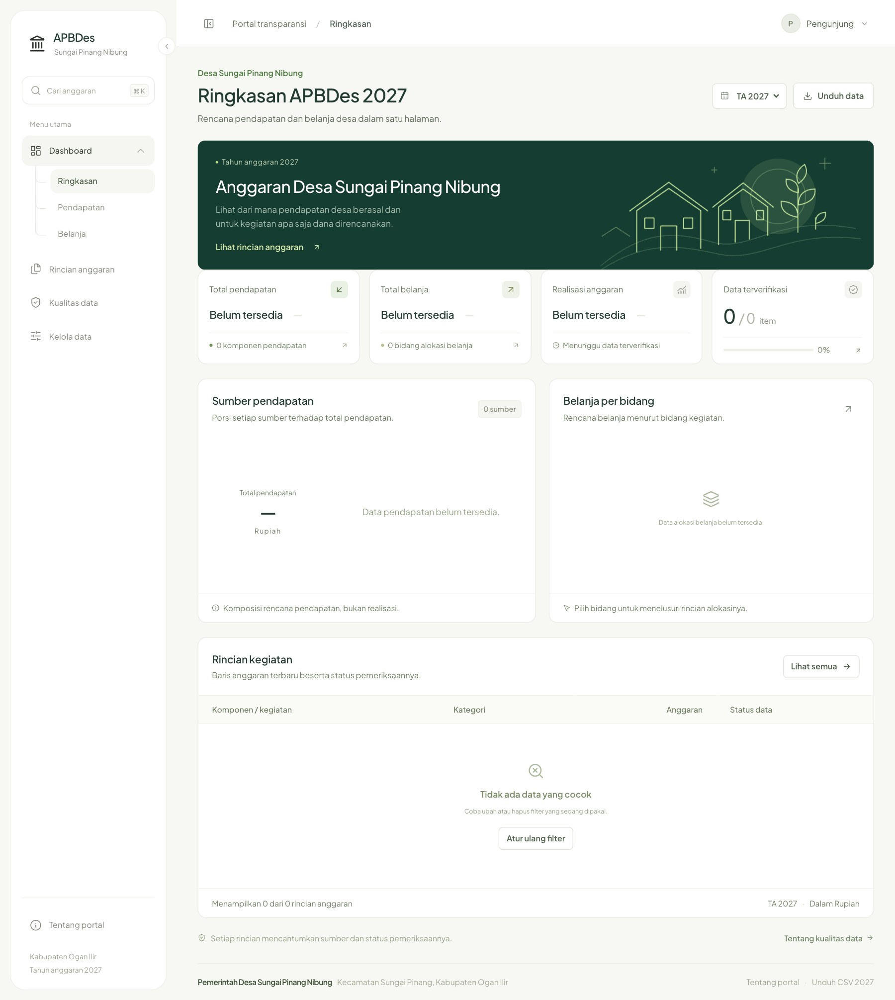
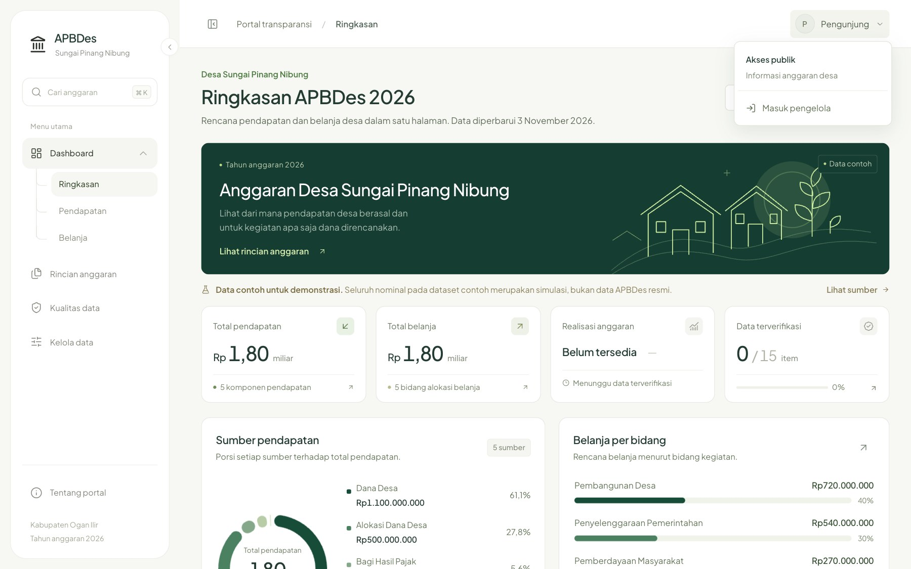
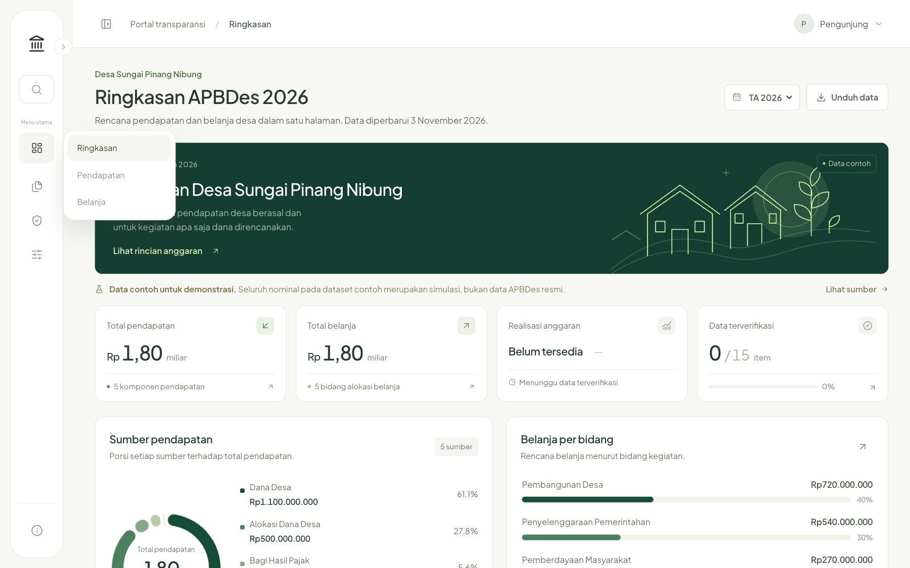
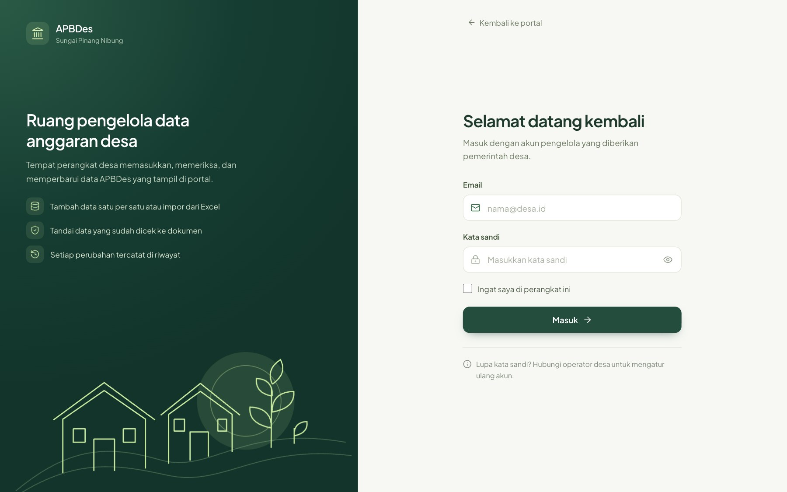
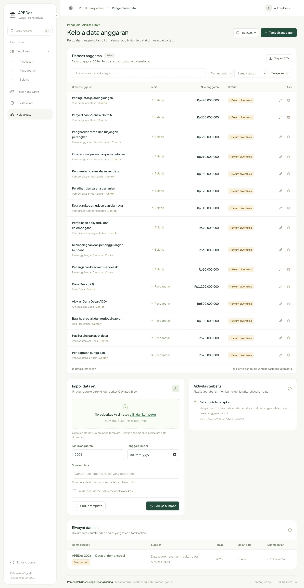
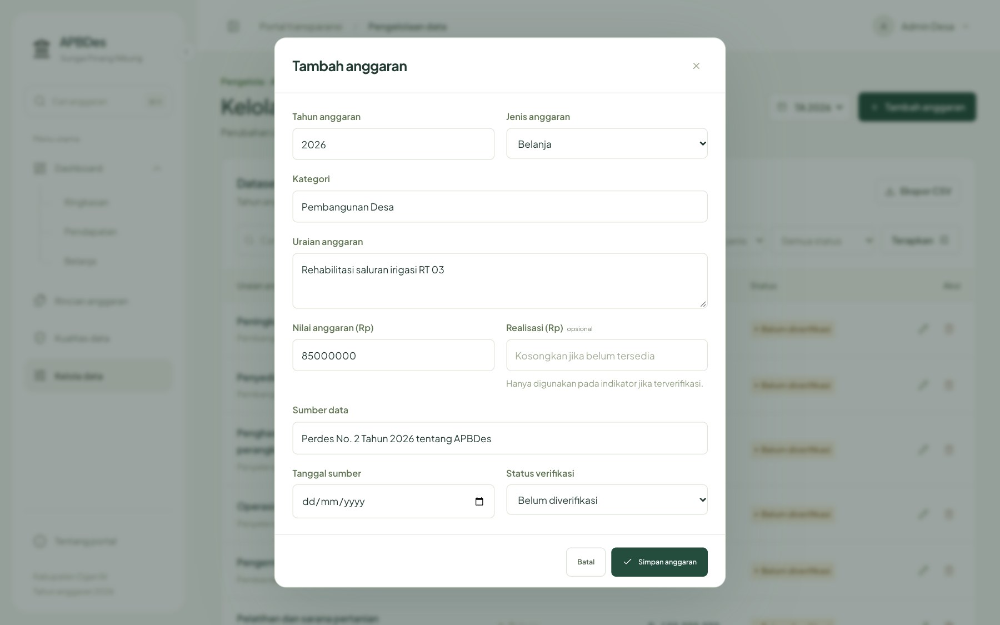
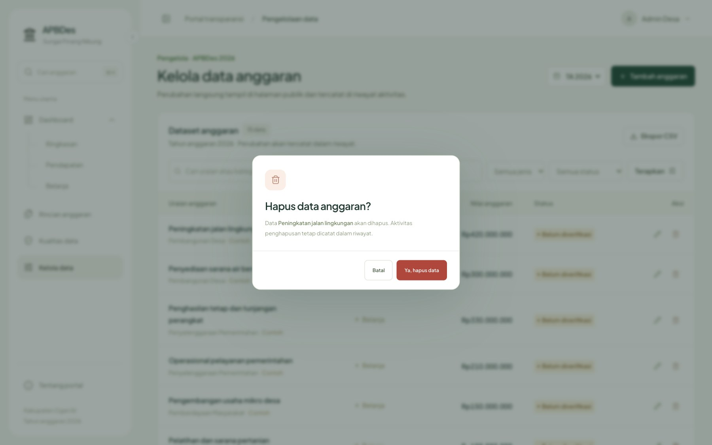
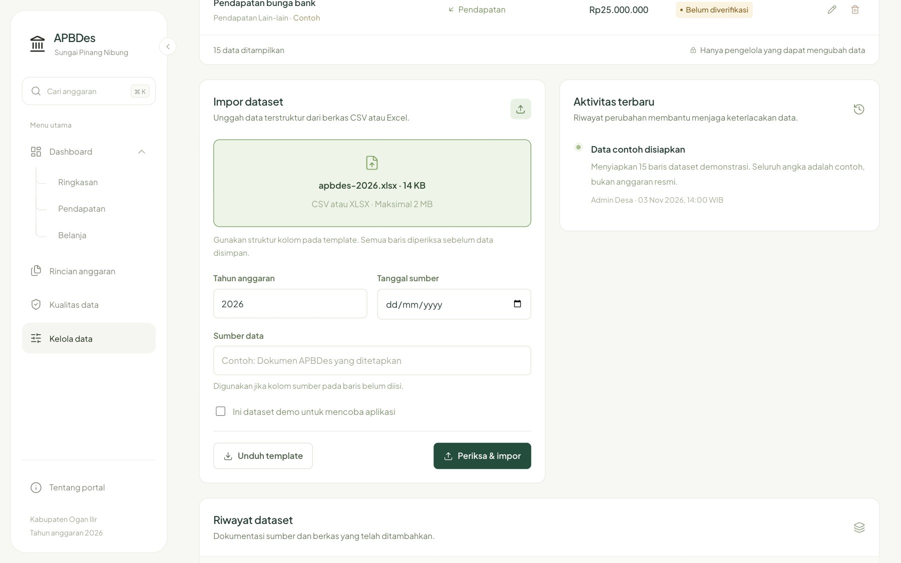
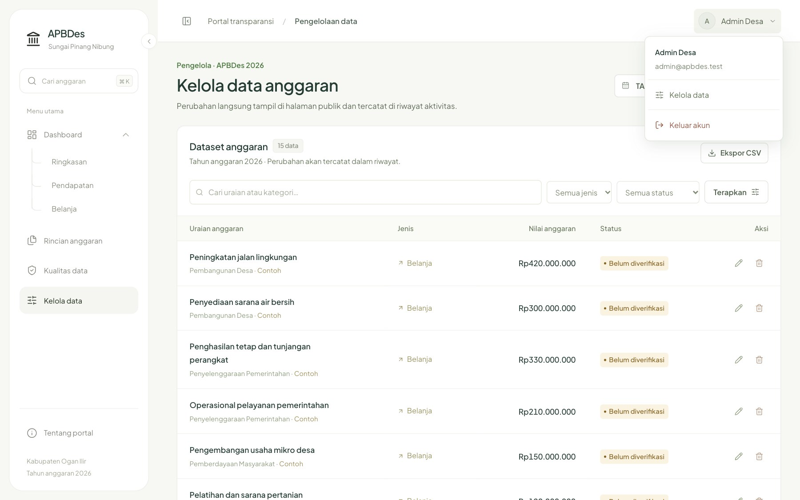
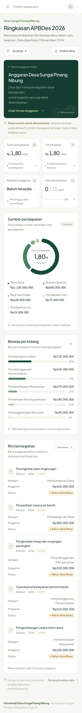
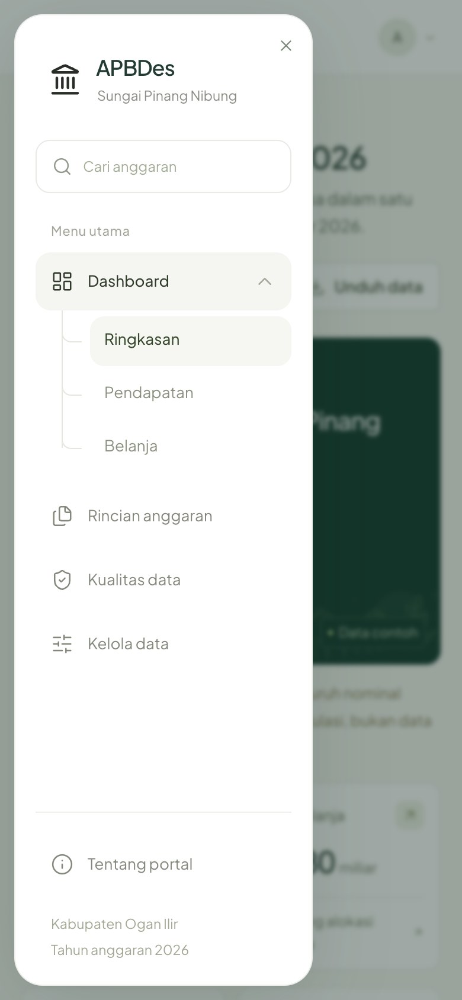
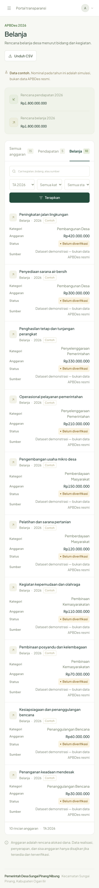
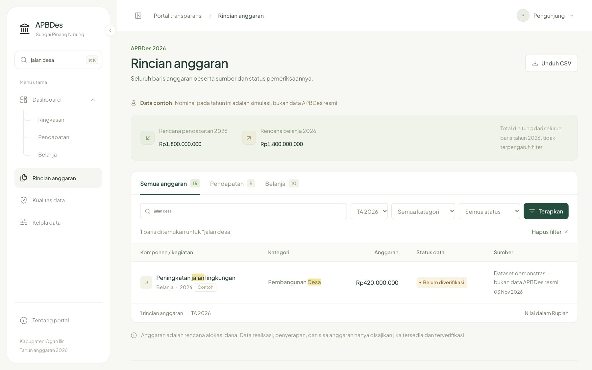

</details>
